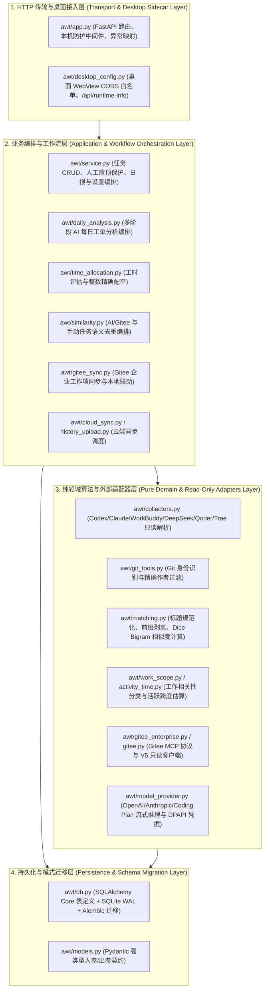

# AI Work Tracker 架构规范、前后端解耦与桌面端打包技术审计报告

- **评估基线**：`wt-agent-4` 分支（2026-11-10）
- **评估范围**：后端 `awt/*.py`（FastAPI + SQLAlchemy Core + SQLite WAL + 领域服务层）、前端 `frontend/src/*`（React 19 + TypeScript 5.7 + Vite 6 + 独立主题注册中心 `frontend/src/themes/*`）、自动化测试套件 `tests/*.py`

---

## 一、代码规范与分层架构评估（Code Standards & Layered Architecture）

### 1.1 四层后端架构与单向依赖边界

项目后端遵循清晰的四层职责分离，各模块仅向下层依赖，严禁数据层或纯领域算法反向依赖 HTTP 传输层：



### 1.2 核心工程规范与并发/事务安全机制

1. **网络 I/O 与 SQLite 写锁严格隔离（Zero Lock During Network Wait）**：
   - 在 `daily_analysis.py`、`time_allocation.py`、`similarity.py` 和 `gitee_sync.py` 中，所有大模型流式推理（OpenAI / Anthropic）及 Gitee MCP 远程调用均在数据库连接或写事务**外部**执行。
   - 仅当网络请求返回并解析校验通过后，才开启短事务（`BEGIN IMMEDIATE`）落库，彻底杜绝远程长耗时阻塞前端并发读写。
2. **乐观状态重校验与人工数据最高优先级（Human-First Optimistic Re-verification）**：
   - AI 分析、工时分配、Gitee 同步在写回数据库前，均重新读取当前日期最新任务快照，显式跳过 `origin == 'manual'`、`edited == True`、`time_locked == True` 或已软删除（`deleted == True`）的记录，确保用户在 AI 思考期间的并发手工修改绝不被覆盖。
3. **凭据与隐私边界**：
   - 模型 API Key、Gitee 令牌与云端凭据通过 Windows DPAPI（`model_provider._crypt`）加密存储在用户数据目录，从不混入普通 `settings` JSON 响应或日志。
   - `collectors.py` 对全部外部会话日志保持只读；针对 Trae 加密 SQLite 仅读取明文 session-memory 摘要并标记 `summary_only`。

---

## 二、前后端解耦程度评估（Frontend-Backend Decoupling）

### 2.1 纯 REST + JSON 契约（零服务端模板耦合）

- 后端不依赖 `Jinja2` 等任何服务端 HTML 模板引擎，100% 业务交互通过 `/api/*` 下的标准 JSON REST 接口完成。
- 异常响应统一收敛为 `{"detail": "..."}`（`ValueError -> 400`、`LookupError -> 404`、`OperationalError(locked) -> 409`）。

### 2.2 前端 API 基址解耦改造（`frontend/src/api.ts`）

改造前，前端存在硬编码相对路径 `"/api..."`，强依赖同源托管或 Vite 开发代理。本次改造在 `frontend/src/api.ts` 中建立了三级 API 基址解析与统一路径归一化函数：

1. **`getApiBase()` 三级优先级**：
   - `window.__AWT_API_BASE__`：供桌面端 WebView（Tauri initialization script / PyWebView 注入）在运行时动态指定本地 sidecar 端口（如 `http://127.0.0.1:8765/api`）；
   - `import.meta.env.VITE_API_BASE_URL`：供构建期环境变量覆盖；
   - 默认值 `"/api"`：保持本地 Web 模式与现有 Playwright / pytest 测试 100% 兼容。
2. **`apiUrl(path)` 统一归一化**：
   - 自动兼容 `"/api/xxx"`、`"/xxx"` 与 `"xxx"` 三种调用写法，统一拼接到 `getApiBase()`。
   - `frontend/src/api.ts`、`frontend/src/EnterpriseSettings.tsx`、`frontend/src/AnalysisLog.tsx` 已全部接入 `apiUrl()`。

### 2.3 后端桌面 Sidecar 接入支持（`awt/desktop_config.py` & `awt/app.py`）

- 新增 `awt/desktop_config.py`，内置桌面容器白名单 `DESKTOP_ALLOWED_ORIGINS`：
  - `http://127.0.0.1:8765`, `http://localhost:8765`
  - `http://127.0.0.1:5173`, `http://localhost:5173`
  - `tauri://localhost`, `https://tauri.localhost`（Tauri v2 macOS/Linux 与 Windows WebView2 自定义协议源）
  - `app://.`（Electron / 通用自定义协议源）
  - 支持环境变量 `AWT_CORS_ORIGINS` 动态追加。
- 在 `awt/app.py` 的 `create_app()` 中调用 `desktop_config.configure_desktop_cors(app)`：
  - 挂载 `CORSMiddleware` 并与 `local_only` 本机防护中间件协同：允许桌面 WebView 源发起带 JSON 的写入请求（`POST`/`PUT`/`PATCH`/`DELETE`），同时继续拦截任意外部恶意站点（如 `https://evil.example` 返回 403）。
  - 提供 `GET /api/runtime-info` 端点，返回 `{"service": "ai-work-tracker", "mode": "...", "api_version": "1.0", "desktop_ready": True}`，供桌面主进程启动时轮询握手。

---

## 三、主题系统解耦与可清理性（Theme Modularity & AI Maintainability）

### 3.1 独立主题目录与零侵入切换架构

前端主题系统已从业务组件样式中解耦，集中在 `frontend/src/themes/` 目录下管理：

```text
frontend/src/themes/
├── registry.ts          # 主题元数据注册表、localStorage 持久化与 document.documentElement[data-theme] 同步
├── index.css            # 主题样式统一聚合入口
├── apple-hig.css        # 1. Apple HIG (Cupertino) —— 默认主题
├── glassmorphism.css    # 2. 玻璃拟态 (Spatial Glass)
├── cyberpunk.css        # 3. 赛博朋克 (Neon Terminal)
├── warm-editorial.css   # 4. 暖色编辑室 (Warm Paper)
└── swiss-minimal.css    # 5. 瑞士极简网格 (Swiss Brutalist)
```

### 3.2 面向 AI 与开发者的“两步无痕清理”规约

每个主题文件严格遵守以下隔离约束：
1. **选择器完全限定在 `[data-theme="<theme-id>"]` 命名空间下**：绝不污染全局无前缀选择器，也不要求业务 TSX 组件编写 `if (theme === 'xxx')` 分支代码。
2. **语义化 CSS 变量契约**：统一覆写 `--apple-bg`、`--apple-card-bg`、`--apple-text-*`、`--apple-blue`、`--apple-radius-*`、`--apple-shadow-*`、`--glass-*` 等设计令牌。
3. **两步删除任意非喜爱主题**：
   - **第 1 步**：直接删除对应的 `frontend/src/themes/<theme-id>.css`，并在 `frontend/src/themes/index.css` 中移除对应 `@import`；
   - **第 2 步**：在 `frontend/src/themes/registry.ts` 的 `THEMES` 数组中移除该条目（若当前缓存命中已删除主题，`getInitialTheme()` 会自动安全回退至默认主题 `apple-hig`）。
   - **零业务组件改动**：无需修改任何业务页面或表单组件代码，编译与运行完全不受影响。

---

## 四、桌面端打包扩展方案（Desktop Packaging Blueprint）

### 4.1 方案选型对比：Tauri v2 vs PyWebView vs Electron

| 评估维度 | 方案 A：Tauri v2 + PyInstaller Sidecar（推荐正式发行） | 方案 B：PyWebView 原生轻量壳（推荐快速 MVP） | 方案 C：Electron + Python Sidecar |
| :--- | :--- | :--- | :--- |
| **安装包体积** | **极小**（Rust 壳 ~5MB + Python Sidecar ~25MB） | **小**（纯 Python + PyInstaller ~25-35MB） | **大**（自带 Chromium + Node ~140-220MB） |
| **内存占用** | 低（复用系统 WebView2 / WKWebView） | 低（复用系统 WebView2 / WKWebView） | 高（独立 Chromium 渲染进程群） |
| **前后端通信** | `https://tauri.localhost` -> `http://127.0.0.1:8765/api`（已由 `desktop_config.py` 与 `apiUrl()` 原生支持） | 直接加载 `http://127.0.0.1:8765` 同源或注入 `window.__AWT_API_BASE__` | `app://.` -> `http://127.0.0.1:8765/api` |
| **系统集成能力** | 极强（系统托盘、单实例锁、原生菜单、自动更新签名） | 适中（基础窗口与托盘，高级能力需平台桥接） | 强（生态成熟，但维护双运行时成本高） |
| **工程侵入性** | **零侵入**（保持现有 FastAPI + Vite 代码结构不变） | **零侵入**（新增 40 行 Python 启动入口即可） | 中（需额外维护 Node 主进程与打包配置） |

### 4.2 推荐落地路径 1：Tauri v2 + Python Sidecar（正式桌面版）

1. **构建前端静态资源**：
   - 设置 `VITE_API_BASE_URL=http://127.0.0.1:8765/api`，执行 `cd frontend && npm run build` 生成 `frontend/dist`。
2. **打包 Python Sidecar 可执行文件**：
   - 使用 PyInstaller 将 `awt` 打包为独立后台进程二进制：
     ```powershell
     pyinstaller --noconfirm --onedir --name awt-sidecar `
       --add-data "awt/prompts;awt/prompts" `
       --add-data "awt/migrations;awt/migrations" `
       awt/cli.py
     ```
3. **Tauri v2 生命周期管理**：
   - Tauri 启动时设置环境变量 `AWT_RUNTIME_MODE=desktop-tauri` 与 `AWT_DATA_DIR=<AppData>/AIWorkTracker`，拉起 `awt-sidecar serve --port 8765`。
   - 轮询 `GET http://127.0.0.1:8765/api/runtime-info` 收到 `desktop_ready: true` 后展示主窗口。
   - 窗口关闭或退出托盘时向 sidecar 发送终止信号，确保 SQLite WAL 安全 checkpoint。

### 4.3 推荐落地路径 2：PyWebView 零依赖快速封装（轻量单文件/单目录版）

无需安装 Rust 工具链，直接在 Python 虚拟环境中安装 `pywebview`，新增桌面启动脚本即可在同一进程内拉起 FastAPI 后台线程并打开原生 WebView2 窗口，加载 `http://127.0.0.1:8765`，实现与当前本地 Web 版完全一致的桌面体验。
